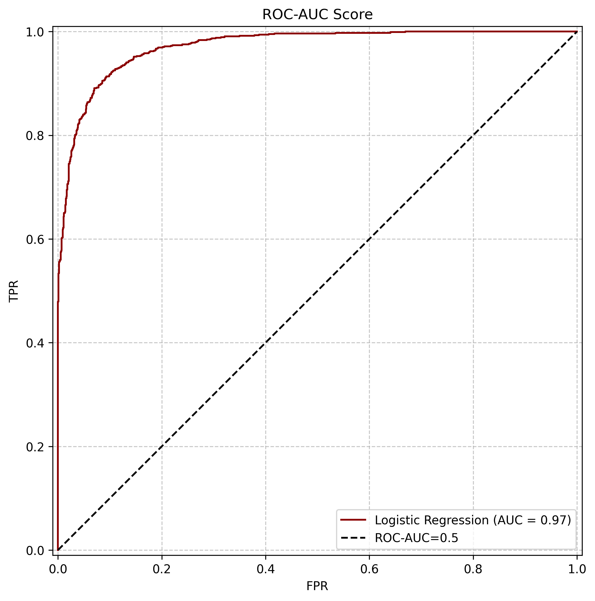

# Credit Score

Проект посвящен оценке кредитного риска (Credit Scoring) по данным заявок на кредит. Он обучает модели для предсказания числового `RiskScore` и бинарного класса риска (`isRisk`).

## Результаты моделей

Метрики получены запуском обучающих скриптов на текущих данных. Регрессионные метрики рассчитаны на валидационной части; классификатор также оценен пятифолдовой стратифицированной кросс-валидацией.

| Модель | Метрика | Результат |
|---|---|---:|
| Logistic Regression | ROC-AUC, CV по фолдам | 0.969845, 0.970911, 0.969473, 0.977115, 0.972458 |
| Logistic Regression | Средний ROC-AUC CV (± 2 стандартных отклонения) | 0.9720 ± 0.0056 |
| Logistic Regression | ROC-AUC на отложенной валидации | 0.9715 |
| Logistic Regression | Accuracy на отложенной валидации | 0.91 |
| Ridge | R² / MSE / RMSE / MAE | 0.8069517569 / 58.6933823364 / 7.6611606390 / 5.9573202428 |
| Random Forest | R² / MSE / RMSE / MAE | 0.7803688265 / 66.7755180378 / 8.1716288485 / 6.2131719659 |

Classification report Logistic Regression на валидации:

| Класс | Precision | Recall | F1-score | Support |
|---|---:|---:|---:|---:|
| 0 (нет риска) | 0.92 | 0.93 | 0.92 | 1115 |
| 1 (риск) | 0.90 | 0.89 | 0.90 | 843 |
| Macro average | 0.91 | 0.91 | 0.91 | 1958 |
| Weighted average | 0.91 | 0.91 | 0.91 | 1958 |

### ROC-кривая классификатора

Кривая построена на отложенной валидационной выборке.



## Структура проекта

```text
config.py
data/
  raw/                 # Исходные train.csv и test.csv
  processed/           # Очищенные данные и наборы признаков
  predictions/
    classification/    # Результаты классификации
    regression/        # Результаты регрессии
models/                # Сериализованные модели и преобразователи
images/                # Графики, включая ROC-кривую
notebooks/
  eda.ipynb            # Исследовательский анализ данных
src/
  make_dataset.py      # Очистка исходных CSV
  build_features.py    # Генерация признаков
  transformer.py       # Преобразование числовых и категориальных признаков
  train_models/
    class_models/
      linear.py        # Логистическая классификация
    linear_models/
      linear.py        # Ridge-регрессия
      forest.py        # Random Forest-регрессия
  test_models/
    classification.py  # Предсказания isRisk для тестового набора
    regression.py      # Предсказания RiskScore (Ridge или Random Forest)
```

`config.py` задает пути к `data/raw` и `data/processed` относительно корня проекта.

## Требования и установка

Нужен Python и `pip`. В PowerShell из корня проекта:

```powershell
py -m venv .venv
.\.venv\Scripts\Activate.ps1
python -m pip install -r requirements.txt
```

Ноутбуки открывайте в Jupyter или VS Code с расширением Jupyter.

## Данные

Ожидаются файлы:

- `data/raw/train.csv` — обучающие данные с целевым столбцом `RiskScore`;
- `data/raw/test.csv` — данные без `RiskScore` (в имеющемся файле также есть `ID`).

Входные CSV в репозитории уже присутствуют. Если заменяете или добавляете данные, сохраните ожидаемые имена файлов и совместимую схему столбцов.

## Подготовка данных

Запускайте команды из корня проекта:

```powershell
python -m src.make_dataset
python -m src.build_features
```

Первый шаг удаляет дубликаты, исключает строки без `RiskScore` и значения цели вне диапазона `[0, 100]` в обучающих данных, затем удаляет выбранные столбцы. Второй шаг создает календарные и финансовые признаки.

Результаты записываются в `data/processed/`:

- `train_cleaned.csv`, `test_cleaned.csv`;
- `train_features_linear.csv`, `test_features_linear.csv`;
- `train_features_class.csv`, `test_features_class.csv`.

Для классификационной выборки `RiskScore` преобразуется в `isRisk` по порогу 50 и удаляется из признаков.

## Обучение

### Ridge-регрессия

```powershell
python -m src.train_models.linear_models.linear
```

Скрипт использует `train_features_linear.csv`, делает случайное разбиение на обучающую и валидационную части и печатает R², MSE, RMSE и MAE. Модель и преобразователь сохраняются в `models/ridge_model.joblib` и `models/ridge_preproc.joblib`.

### Логистическая классификация

```powershell
python -m src.train_models.class_models.linear
```

Скрипт использует `train_features_class.csv`, оценивает ROC-AUC на пяти стратифицированных фолдах (предобработка обучается отдельно внутри каждого фолда), затем делает стратифицированное train/validation-разбиение и печатает отчет классификации и ROC-AUC. Он также показывает матрицу ошибок и ROC-кривую. График сохраняется в `images/roc-auc-curve.png`; модель и преобразователь — в `models/logistic_model.joblib` и `models/preprocessor_class.joblib`.

### Random Forest-регрессия

```powershell
python -m src.train_models.linear_models.forest
```

Скрипт использует `train_features_linear.csv` и сохраняет модель и преобразователь в `models/forest_regressor.joblib` и `models/preprocessor_forest.joblib`.

## Предсказания для тестового набора

Сначала выполните подготовку данных и обучите соответствующую модель (см. выше). Затем, также из корня проекта, запустите один из сценариев:

```powershell
# Бинарная классификация
python -m src.test_models.classification

# Регрессия (по умолчанию Ridge)
python -m src.test_models.regression
```

Сценарий регрессии по умолчанию использует Ridge. Чтобы выбрать Random Forest, откройте `src/test_models/regression.py` и замените в последней строке `predict_test("ridge")` на `predict_test("forest")`. Сценарии загружают признаки из `data/processed/test_features_class.csv` или `test_features_linear.csv`, преобразователь и модель из `models/`, а затем записывают результат в `data/predictions/`. Папки создаются автоматически при запуске. Если в тестовом файле есть `ID`, он сохраняется в выходном CSV:

- классификация: `data/predictions/classification/test_predictions_classification.csv` с `isRisk_pred` и вероятностью класса риска `risk_probability`;
- Ridge: `data/predictions/regression/test_predictions_ridge.csv` с предсказанием `RiskScore_pred`;
- Random Forest: `data/predictions/regression/test_predictions_forest.csv` с предсказанием `RiskScore_pred`.

Для классификации метка получается из модели, а вероятность относится к классу `1` (`isRisk`). Файл предсказаний не содержит истинные целевые значения тестовых примеров.

## Ноутбуки

- `notebooks/eda.ipynb` содержит исследовательский анализ и использует `seaborn`.


## Состав зависимостей

Список прямых зависимостей проекта и ноутбука находится в [requirements.txt](requirements.txt).
