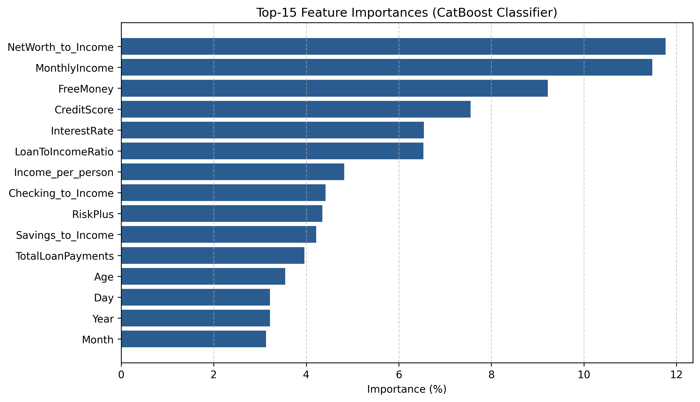
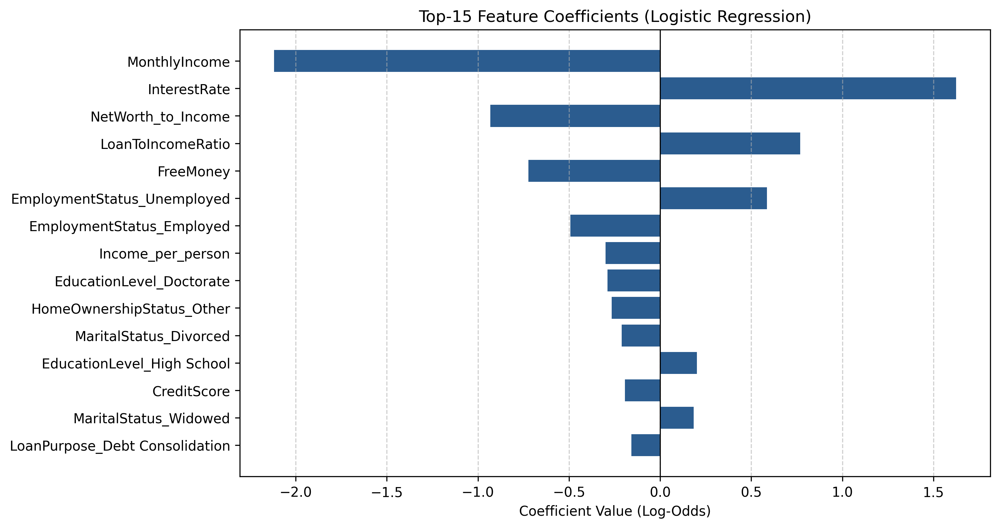
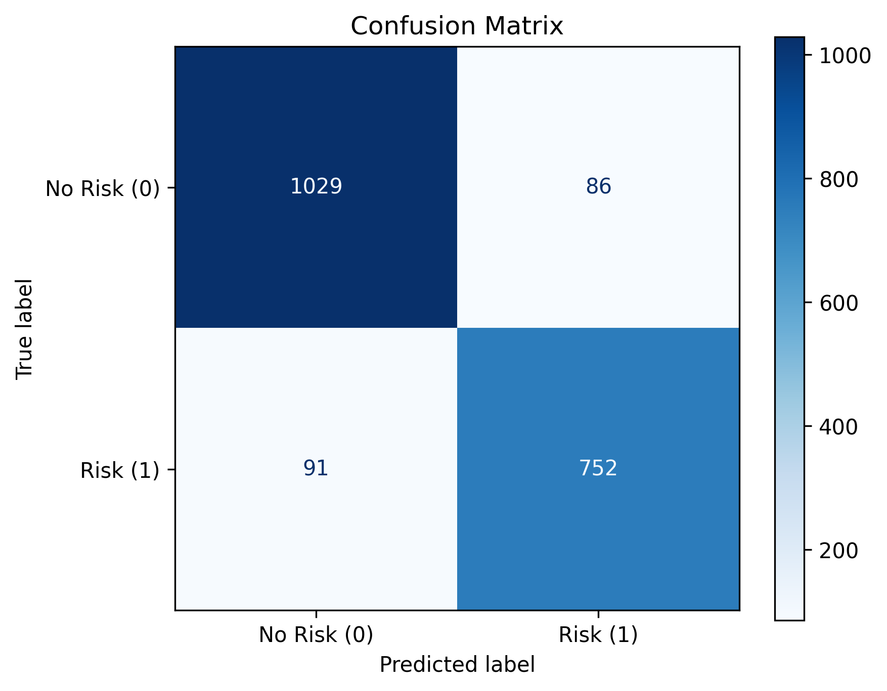

# Credit Risk Scoring — End-to-End ML Pipeline

Модульный ML-пайплайн для оценки кредитного риска по данным кредитных заявок. Проект решает две задачи:
1. **Регрессия:** прогнозирование непрерывного скорингового балла `RiskScore` в диапазоне от `0` до `100`.
2. **Бинарная классификация:** определение класса дефолта/высокого риска `isRisk` (`RiskScore >= 50`) и вероятности наступления риска.

---

## Ключевые особенности решения

* **Единые пайплайны (`sklearn.pipeline.Pipeline`):** препроцессинг (импутация пропусков, логарифмирование скошенных распределений, масштабирование, One-Hot кодирование) инкапсулирован внутрь модели. Это исключает утечки данных (*data leakage*) при кросс-валидации и упрощает инференс.
* **Единая точка входа (`main.py`):** весь цикл — от очистки сырых данных и генерации признаков до обучения 5 моделей и получения прогнозов — запускается одной CLI-командой.
* **Feature Engineering:** созданы финансовые коэффициенты платежеспособности (`NetWorth_to_Income`, `FreeMoney`, `LoanToIncomeRatio`, `Income_per_person`, `RiskPlus`) и календарные признаки.
* **Интерактивный веб-интерфейс (`app.py`):** приложение на Streamlit с автоматической загрузкой обученных пайплайнов, поддержкой демо-данных, загрузкой пользовательских CSV и настройкой порога отсечения риска (*Threshold*).

---

## Результаты моделей

Все метрики получены на отложенной валидационной выборке (`20%`, `random_state=42`).

### Задача регрессии (прогноз `RiskScore`)

| Модель | R² | MSE | RMSE | MAE |
|---|---:|---:|---:|---:|
| **CatBoost Regressor** | **0.8546** | **44.21** | **6.65** | **4.96** |
| Random Forest Regressor | 0.8242 | 53.46 | 7.31 | 5.40 |
| Ridge Regression (CV) | 0.8105 | 57.61 | 7.59 | 5.88 |

### Задача классификации (прогноз `isRisk`)

| Модель | ROC-AUC (Val) | Accuracy | F1-score (Macro) |
|---|---:|---:|---:|
| **CatBoost Classifier** | **0.9748** | **0.91** | **0.91** |
| Logistic Regression (5-fold CV: `0.9723 ± 0.0055`) | 0.9716 | 0.91 | 0.91 |

### Визуализация метрик и важности признаков

#### Важность признаков (Feature Importance)
Сгенерированные финансовые коэффициенты (`NetWorth_to_Income`, `FreeMoney`, `LoanToIncomeRatio`) вошли в топ самых значимых факторов как в градиентном бустинге, так и в линейной модели:

| CatBoost Classifier | Logistic Regression (Log-Odds) |
| :---: | :---: |
|  |  |

#### ROC-кривая и матрица ошибок (CatBoost Classifier)

| ROC-кривая | Матрица ошибок |
| :---: | :---: |
|  |  |

---

## Структура проекта

```text
├── main.py                        # Единая CLI-точка входа (data, train, predict, all)
├── app.py                         # Веб-приложение на Streamlit для инференса
├── config.py                      # Конфигурация путей и удаляемых признаков
├── requirements.txt               # Зависимости проекта
├── data/
│   ├── raw/                       # Исходные train.csv и test.csv
│   ├── processed/                 # Очищенные данные и матрицы признаков (генерируются)
│   └── predictions/               # Итоговые прогнозы моделей (генерируются)
├── models/                        # Сохраненные sklearn Pipeline (.joblib)
├── images/                        # Графики метрик и важности признаков
├── notebooks/
│   └── eda.ipynb                  # Разведочный анализ данных (EDA)
└── src/
    ├── make_dataset.py            # Очистка сырых данных и фильтрация выбросов
    ├── feature_engineering.py     # Генерация финансовых и календарных признаков
    ├── preprocessing.py           # ColumnTransformer для линейных и деревянных моделей
    ├── predict.py                 # Единый модуль инференса и реестр моделей (MODEL_REGISTRY)
    └── train/
        ├── classification/
        │   ├── log_reg.py         # Обучение LogisticRegression + 5-fold CV
        │   └── catboost_clf.py    # Обучение CatBoostClassifier
        └── regression/
            ├── ridge_cv.py        # Обучение RidgeCV
            ├── random_forest.py   # Обучение RandomForestRegressor
            └── catboost_reg.py    # Обучение CatBoostRegressor
```

---

## Установка и быстрый старт

### 1. Клонирование и установка зависимостей

```powershell
git clone https://github.com
cd RiskScorePrediction

py -m venv .venv
.\.venv\Scripts\Activate.ps1
python -m pip install -r requirements.txt
```

### 2. Запуск полного ML-пайплайна

Выполнить весь цикл (очистка данных $\rightarrow$ генерация признаков $\rightarrow$ обучение всех моделей $\rightarrow$ сохранение прогнозов для `test.csv`):

```powershell
python main.py all
```

Доступен также пошаговый запуск отдельных этапов:

```powershell
# 1. Очистка сырых данных и генерация признаков
python main.py data

# 2. Обучение всех моделей регрессии и классификации
python main.py train

# 3. Инференс на тестовом наборе (для всех моделей сразу или для выбранной)
python main.py predict
python main.py predict --task classification --model catboost
```

### 3. Запуск веб-приложения (Streamlit)

После обучения моделей запустите интерактивный интерфейс:

```powershell
streamlit run app.py
```

В боковой панели можно выбрать задачу (**Классификация** или **Регрессия**), модель (`catboost`, `random_forest`, `ridge_cv`, `log_reg`), настроить порог классификации (*Threshold*), протестировать работу на встроенном демо-наборе или загрузить собственный CSV-файл и скачать готовые предсказания.
